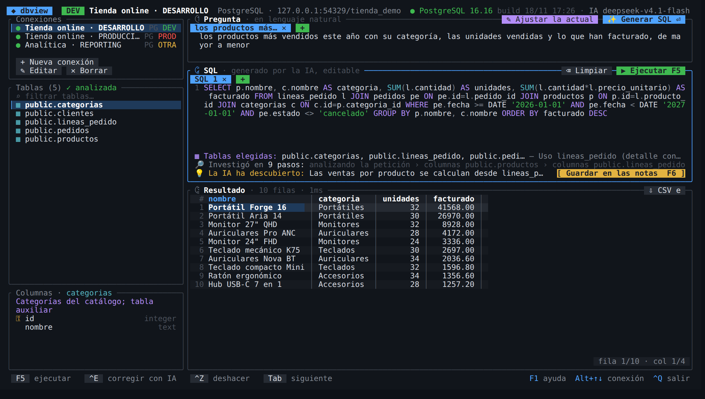

<div align="center">

# 🗄️ herdr-dbview

### *Pregunta en lenguaje natural, revisa el SQL y mira las filas reales*

[](https://www.rust-lang.org)
[](https://ratatui.rs)
[](https://herdr.dev)
[](https://www.postgresql.org)
[](https://www.oracle.com/database/)
[](#configuración)
[](LICENSE)

</div>

Consola de base de datos para [herdr](https://github.com/ogulcancelik/herdr): escribes lo que quieres en lenguaje natural, la IA escribe el SQL, y ves las filas reales. Todo a la vista, **solo lectura**.



*Una tienda online de ejemplo: la pregunta (①) se convierte en SQL (②) tras explorar el esquema, y ③ muestra las filas reales devueltas por PostgreSQL.*

- **Conexiones**: nueva / editar / borrar desde la barra lateral, con **Probar conexión** (versión del servidor y tiempo). PostgreSQL (nativo) y Oracle (puente Python `oracledb`, modo thin). Cada conexión conserva sus pestañas (pregunta, SQL y resultado) al cambiar de una a otra (`Alt+↑↓`, `Alt+1…9`).
- **Memoria de la base (agnóstica del motor)**: al abrir una conexión se lee al instante, sin IA, lo que la propia base ya sabe: comentarios, claves foráneas, relaciones inferidas por nombre de columna y filas estimadas (`~/.local/share/herdr-dbview/catalog/`). Lo demás se **aprende al consultar**: cada tabla que el agente usa queda descrita en la memoria para la próxima vez. La estructura se vuelve a comprobar cada 30 min (tablas nuevas, modificadas o eliminadas). `F4` lanza un análisis profundo opcional con la IA (lento).
- **Pregunta → agente explorador → SQL probado**: no escribe la primera consulta que se le ocurre. Como un analista, razona qué entidad pide el usuario y, con herramientas de solo lectura, **describe** tablas (columnas, relaciones, ejemplo), mira los **valores** de estados/códigos, el **rango** de las fechas y **prueba** la consulta (5 filas + total); si da error o 0 filas investiga por qué. Cada paso se ve en el panel SQL, `Esc` lo para, y solo entrega una consulta que funciona (con autocorrección de respaldo). «Ajustar la actual» (`Ctrl+T`) modifica el SQL existente.
- **Revisión y reintento automáticos**: tras investigar, un revisor independiente (modelo más potente, `deepseek-v4-pro` por defecto; `DBVIEW_AI_MODEL_STRONG` lo cambia, `off` lo desactiva) comprueba que la consulta responde de verdad (tabla principal, proporción de las cifras, top N con menos de N filas…). Si no convence, repite la investigación con ese modelo. Solo se activa cuando hace falta.
- **Aprende de cómo lo usas, sin configurar nada**: si corriges el SQL de la IA y funciona, o copias/exportas su resultado, la pregunta y el SQL se guardan (`~/.local/share/herdr-dbview/history/`) y guían las preguntas parecidas.
- **Conocimiento por conexión**: carpeta `~/.config/herdr-dbview/knowledge/<conexión>/` (y `_all/`) con documentos `.md`/`.txt` (admite enlaces simbólicos a tu KB o a skills). Para cada pregunta se extraen solo los fragmentos relevantes y el agente los lee como documentación de referencia.
- **Notas de la BD** (`F3`): reglas de negocio que la IA respeta por encima de sus suposiciones. Lo que el agente descubre de forma estable («la fecha de un pedido es FCHPEDIDO») se ofrece con un botón «Guardar en las notas» (`F6`).
- **SQL editable** con resaltado, ajuste de línea, deshacer, selección y ratón. Errores de la base con posición marcada (`column "x" does not exist`, tipo incorrecto…) con línea/columna marcadas y `Ctrl+E` para que la IA lo corrija.
- **Resultado**: ordenar (`s` o clic en cabecera), copiar celda/fila (`y`/`Y`, OSC52), ver valor completo (`Enter`), exportar CSV (`e`).
- **Seguridad**: una sola sentencia `SELECT`/`WITH`, validada con un tokenizador (cadenas, comentarios, dollar-quoting) y ejecutada en transacción de solo lectura con límite de tiempo y de filas. Las conexiones PROD se marcan en rojo.

## Pestañas de consulta

Cada pestaña es una consulta completa: su **pregunta ①**, su **SQL ②** y su **resultado ③** van siempre juntas. Las tiras de pestañas de ① y de ② son las mismas (`nombre` en ①, `SQL n` en ②): cambiar de pestaña en cualquiera cambia los tres paneles; cerrar una borra también su SQL y su resultado. El nombre de la pestaña es el principio de la pregunta, así que editar el texto la renombra. Cada conexión tiene sus propias pestañas; una pestaña puede seguir generando o ejecutando mientras miras otra.

`Alt+T` o `+` nueva · clic o `Ctrl+RePág/AvPág` (`Alt+RePág/AvPág`) cambiar · `Alt+W` o `✕` cerrar · `Alt+U` reabre la última cerrada. Si cierras la última queda una vacía.

## Paneles redimensionables

Arrastra con el ratón los bordes: el ancho de la barra lateral, el alto de la pregunta y del SQL, y el alto de las conexiones y de las columnas. Teclado: `Alt+,` `Alt+.` (barra lateral), `Alt+[` `Alt+]` (pregunta), `Alt+-` `Alt+=` (SQL), `Alt+Z` zoom del panel con el foco, `Alt+0` restablecer. `F8` o clic en «Tablas elegidas» abre el detalle completo de la investigación sin recortar.

## Instalación

```sh
cargo build --release
herdr plugin link .            # plugin local.dbview
```
Atajo en `~/.config/herdr/config.toml`:
```toml
[[keys.command]]
key = "prefix+alt+d"
type = "plugin_action"
command = "local.dbview.open"
```
Pruebas sin red: `herdr-dbview --demo`. Fotograma a HTML: `--render 150x44 --keys "texto{enter}"`.

## Configuración

`~/.config/herdr-dbview/config.toml` (permisos 0600; la propia aplicación lo reescribe al crear/editar/borrar conexiones). Las claves pueden ir en claro, en `password_env` o en `password_file` + `password_key`.

```toml
max_rows = 500
auto_run = true            # ejecutar el SQL en cuanto la IA termina
timeout_secs = 30
[[connections]]
id = "dev"; label = "Ventas · DESARROLLO"; dialect = "postgres"; env = "dev"
host = "10.0.0.1"; port = 5432; database = "app"; user = "lector"; password_env = "PGPASSWORD"
```

### IA: el modelo se cambia por variables de entorno

Cualquier endpoint compatible con OpenAI Chat Completions (streaming):

```sh
export DBVIEW_AI_MODEL=mi-modelo
export DBVIEW_AI_API_URL=https://mi-proveedor/v1/chat/completions
export DBVIEW_AI_API_KEY_VALUE=...      # nunca se guarda en el config.toml
export DBVIEW_AI_EFFORT=high            # none|low|medium|high|max
export DBVIEW_AI_MODEL_STRONG=otro      # modelo del revisor; "off" lo desactiva
```

También puede ir en `[ai]` del TOML (la clave nunca se lee de ahí). Por defecto: DeepSeek V4.1 Flash en OpenCode Go; sin clave explícita se reutiliza la de OpenCode (`~/.local/share/opencode/auth.json`). Con un endpoint propio no se envía ninguna credencial que no hayas indicado.

Oracle usa un puente Python (`oracledb`, modo thin): instala `oracledb` en un entorno y apunta a su intérprete con `oracle_python = "/ruta/venv/bin/python3"` (por defecto `python3`).

## Estructura

`src/db/{pg,oracle,sqlguard,demo}.rs` acceso a datos · `catalog.rs` memoria de la base · `explorer.rs` agente con herramientas · `agent.rs`/`nl2sql.rs` plan y prompt de respaldo · `ai.rs` curl+SSE · `editor.rs`, `sqlhl.rs`, `form.rs`, `app.rs`, `ui.rs` interfaz · `bridge/oracle_bridge.py` puente Oracle.

## Licencia

[MIT](LICENSE) · software libre y de código abierto.
